<!--
Spent-When: MARKED(<self>)
Supersedes: none
-->

# Architecture map: `solarwindpy/fitfunctions/`

This is a read-only map of the subpackage as it stands after D1 (commit `6302e352` removed the HeavySide-based fit functions, the composites and `ExponentialCDF`). It was taken at HEAD `6cf076e3`, and no fitfunctions file changed between the first read and the write. Probes ran through `conda run -n solarwindpy python`, and the scripts are in the session scratchpad. It proposes one results form (section 4) and one hinge-guess form (section 5); everything else is inventory.

Related findings, by id in `docs/dispatches/findings-coherence-and-tooling-review-2026-11-04.md`: F86 (residual sign, being fixed), F91 to F93 (hinge guess names, defaults, the CONTRIBUTING.md 425 rule), F99 and F100 (FFPlot's copied axis vocabulary), F102 (TrendFit per-bin spellings), F135 (`normal_parameters` names a log-normal's mean and standard deviation). The earlier slice review is `tmp/coherence-review/pass2-fit-instab.md`.

## Author's rulings folded in

- Families in use: Gaussians, power laws, lines, hinges, exponentials. The exponentials stay.
- "Every fit should expose its results in the same form." Section 4 is designed to that requirement.
- TrendFit's internal quirks are artifacts of coding style, not intent. Section 3 lists the ones to drop.
- Reference TrendFit case: a Gaussian in each column of a 2-D histogram, then a hinge fit to the trend, with x the column center, y each column's `mu`, and yerr each column's `sigma` (the distribution width). The alternative yerr is the fitted uncertainty on `mu`.

## 1. Class hierarchy after D1

```mermaid
flowchart TB
    ABC["abc.ABC"]
    FF["FitFunction (core.py:161)"]
    ABC --> FF

    subgraph Gaussian
        G["Gaussian [mu, sigma, A]"]
        GN["GaussianNormalized [mu, sigma, n]"]
        GL["GaussianLn [m, s, A]"]
    end
    subgraph PowerLaw["Power law"]
        P["PowerLaw [A, b]"]
        PC["PowerLawPlusC [A, b, c]"]
        PO["PowerLawOffCenter [A, b, x0]"]
    end
    subgraph LineFam["Line"]
        L["Line [m, b]"]
        LX["LineXintercept [m, x0]"]
    end
    subgraph Exponential
        E["Exponential [c, A]"]
        EC["ExponentialPlusC [c, A, d]"]
    end
    subgraph HingeFam["Hinge"]
        H["Hinge (abstract, hinge.py:78)"]
        HS["HingeSaturation [xh, yh, x1, m2]"]
        TL["TwoLine [x1, x2, m1, m2]"]
        SA["Saturation [x1, xs, s, theta]"]
        HMIN["HingeMin [m1, x1, x2, h]"]
        HMAX["HingeMax [m1, x1, x2, h]"]
        HP["HingeAtPoint [xh, yh, m1, m2]"]
        H --> HS
        H --> TL
        H --> SA
        H --> HMIN
        HMIN --> HMAX
        H --> HP
    end

    FF --> G
    FF --> GN
    FF --> GL
    FF --> P
    FF --> PC
    FF --> PO
    FF --> L
    FF --> LX
    FF --> E
    FF --> EC
    FF --> H

    TF["TrendFit (trend_fits.py:26)"]
    FP["FFPlot (plots.py:71)"]
    TX["TeXinfo (tex_info.py:21)"]
    FF -.builds.-> FP
    FF -.builds.-> TX
    TF -.holds a Series of.-> FF
```



`FitFunctionMeta` (`core.py:87`) is the metaclass (ABCMeta plus NumPy docstring inheritance), not a parent, so it has no edge. `TrendFit` is a plain `object`, not a `FitFunction`.

Sixteen concrete classes:

| Family | Classes | Used elsewhere in the package | Tests (AST / node-id) |
|---|---|---|---|
| Gaussian | `Gaussian` | yes: `TrendFit`'s default `ffunc1d` (`trend_fits.py:438`) | 32 / 16 |
| | `GaussianNormalized` | no | 11 / 15 |
| | `GaussianLn` | no | 12 / 11 |
| Power law | `PowerLaw` | no | 19 / 13 |
| | `PowerLawPlusC` | no | 9 / 13 |
| | `PowerLawOffCenter` | no | 21 / 13 |
| Line | `Line` | no | 42 / 13 |
| | `LineXintercept` | no | 15 / 13 |
| Hinge | `HingeSaturation` | no | 26 / 12 |
| | `TwoLine` | no | 17 / 12 |
| | `Saturation` | no | 15 / 12 |
| | `HingeMin` | no (named in the package docstring) | 17 / 12 |
| | `HingeMax` | no (named in a `core.py` comment) | 20 / 7 |
| | `HingeAtPoint` | no | 18 / 15 |
| Exponential | `Exponential` | no | 16 / 11 |
| | `ExponentialPlusC` | no | 12 / 11 |
| **OTHER** | **none** | | |

**The OTHER family is empty.** After D1 and the exponentials ruling, every concrete class belongs to a family in use, so there are no deletion candidates by family. I verified with `git grep -l -w <Class> -- 'solarwindpy/*.py' ':!solarwindpy/fitfunctions/*'` that no code outside `fitfunctions/` uses any fit class. The hits in `plotting/` and `instabilities/` are the words "Gaussian filter" and "Line styles" in prose. Inside the package, the only real dependency is `TrendFit` defaulting to `Gaussian`. Docs: `docs/source/usage.rst:88` doctests `Gaussian` and `fit.popt`.

The test-count methods are under section 6.

## 2. How a FitFunction stores and exposes results today

`make_fit` (`core.py:978`) stores six private attributes after a successful fit (`core.py:1030-1035`), then builds `TeXinfo` and `FFPlot`. I verified these return types by probe on a fitted `Gaussian`:

| Attribute | Store | Returns | Unfitted / failed fit |
|---|---|---|---|
| `popt` (`core.py:438`) | `_popt`, a list of `(name, value)` pairs | `dict` keyed by `argnames` | raises `AttributeError` |
| `psigma` (`core.py:443`) | `_psigma`, a list of pairs | `dict` | raises `AttributeError` |
| `combined_popt_psigma` (`core.py:447`) | derived | `DataFrame`, index = parameters, columns `popt`, `psigma` | raises `AttributeError` |
| `pcov` (`core.py:459`) | `_pcov` | unlabeled `ndarray` copy, positional in `argnames` order | raises `AttributeError` |
| `chisq_dof` (`core.py:376`) | `_chisq_dof` | namedtuple `_ChisqPerDegreeOfFreedom(linear, robust)` | returns `None` |
| `rsq` (`core.py:464`) | recomputed on every access | `float` (nan when y has no spread) | raises `AttributeError` |
| `dof`, `nobs` | derived from observations | `int` | work before a fit |
| `fit_result` (`core.py:392`) | `_fit_result` | scipy `OptimizeResult` | raises `AttributeError` |
| `initial_guess_info` (`core.py:396`) | `_fit_p0` plus `fit_bounds` | `dict` of namedtuple `_InitialGuessInfo(p0, bounds)` | returns `None` |
| `fit_bounds` (`core.py:371`) | `_fit_bounds` | `dict` of namedtuple `_FitBounds(lower, upper)` | raises `AttributeError` |
| `residuals()` (`core.py:713`) | method | `ndarray`, observed minus fitted | raises `AttributeError` |
| `plotter.residuals()` (`plots.py:595`) | method | `ndarray`, model minus observed (F86, being unified) | no plotter |
| `make_fit()` | | `None` on success; the exception when `return_exception=True` | |

`TeXinfo` holds its own copies of `popt` and `psigma` as dicts (`tex_info.py:118`, `123`).

Derived quantities, each a class-specific property computed from `popt`, with no uncertainty:

| Class | Derived | Type |
|---|---|---|
| `Line` | `x_intercept` | float |
| `LineXintercept` | `y_intercept` | float |
| `GaussianLn` | `normal_parameters` (log-normal mean and std, F135) | `dict(mu, sigma)` |
| `TwoLine` | `xs`, `s`, `theta` | float |
| `Saturation` | `m1`, `m2`, `x2` | float |
| `HingeMin` and `HingeMax` | `m2`, `theta` | float |
| `HingeAtPoint` | `x_intercepts` | namedtuple `_XIntercepts(x1, x2)` |

### The same concept under different names

| Concept | Names across classes |
|---|---|
| Center of a peak | `mu` (Gaussian, GaussianNormalized), `m` (GaussianLn, in ln x) |
| Width | `sigma`, `s` (GaussianLn) |
| Amplitude | `A` (Gaussian, GaussianLn, PowerLaw*, Exponential*), `n` (GaussianNormalized, an area) |
| Exponent or rate | `b` (power law exponent), `c` (exponential rate) |
| Additive offset | `c` (PowerLawPlusC), `d` (ExponentialPlusC) |
| Line intercept | `b` (Line, y-intercept), `x0` (LineXintercept), `x1`, `x2` (hinges) |
| Shifted origin | `x0` (PowerLawOffCenter) |
| Hinge point x | `xh` (HingeSaturation, HingeAtPoint), `xs` (Saturation parameter, TwoLine derived), `h` (HingeMin, HingeMax) |
| Hinge point y | `yh` (HingeSaturation, HingeAtPoint), `s` (Saturation parameter, TwoLine derived), absent in HingeMin |
| Second slope | `m2`: a parameter in TwoLine, HingeSaturation, HingeAtPoint; derived in Saturation, HingeMin |
| Angle between lines | `theta`: a parameter in Saturation; derived in TwoLine, HingeMin |

The two `theta` formulas (`arctan m1 - arctan m2` at `hinge.py:527`, `arctan2(m1 - m2, 1 + m1 m2)` at `hinge.py:962`) are the same angle for finite slopes, so that is not a finding. `Saturation.TeX_function` writes it as a single `arctan` of the ratio, which differs by pi when `1 + m1 m2 < 0`. That is a display detail.

### Inconsistencies in how results are exposed

1. **Names collide across families.** `b` is an intercept in `Line` and an exponent in `PowerLaw`. `c` is an offset in `PowerLawPlusC` and a rate in `Exponential`. `s` is a log-width in `GaussianLn` and a hinge y in `Saturation`. `x0` is an x-intercept in `LineXintercept` and an origin in `PowerLawOffCenter`. A table comparing two fits aligns on these names, so a collision silently aligns unlike quantities (section 4).
2. **One hinge geometry, several coordinate systems.** The hinge point is `(xh, yh)`, `(xs, s)` or `h`, and `m2`, `x2` and `theta` switch between fitted and derived from class to class. To read "where is the hinge" you need to know which class produced the fit.
3. **Derived quantities have no common form.** They come back as a float, a dict or a namedtuple, never carry an uncertainty, and are invisible to any generic consumer: `combined_popt_psigma`, `TeXinfo`, TrendFit.
4. **Four container types for one fit.** `popt` and `psigma` are dicts, `pcov` is an unlabeled positional array, `chisq_dof` is a namedtuple, `combined_popt_psigma` is a DataFrame with `popt` and `psigma` as columns. No one object holds a fit's results.
5. **The unfitted state is inconsistent.** `popt`, `psigma`, `pcov`, `rsq` and `fit_result` raise `AttributeError`; `chisq_dof` and `initial_guess_info` return `None`.
6. **Failure leaves no record on the object.** A failed `make_fit` sets nothing, so the fit object looks exactly like an unfitted one. The exception only survives as `make_fit`'s return value under `return_exception=True`.
7. **Docstrings disagree with the code.** The class docstring (`core.py:162`) says calling a failed fit returns NaNs; I verified that it raises `AttributeError`, both unfitted and after a failed fit. The `chisq_dof` docstring cites `make_fit_old`, which does not exist.
8. **Two residuals with opposite signs** (F86, being fixed now as observed minus fitted in one home).
9. **`rsq` is recomputed on every access**, while `chisq_dof` is stored. Two quality numbers, two lifetimes.

## 3. How TrendFit works today

`TrendFit(agged, trendfunc, trend_logx=False, ykey1d="mu", wkey1d="sigma", ffunc1d=None)` (`trend_fits.py:27-70`). `agged` is a DataFrame with the trend's x-bins as **columns** and the 1-D fit's x as the **index**: the 2-D histogram, with columns as `IntervalIndex` bins. The caller runs four steps, in this order:

1. **`make_ffunc1ds(**kw)`** (`:133`). It takes `x = IntervalIndex(agg.index).mid`, falling back to raw index values on `TypeError` (`:136-139`). For each column `k, y in agg.items()` it builds `ffunc1d_class(x, y.values, **kw)` and stores them in `_ffuncs`, a `pd.Series` keyed by column interval.
2. **`make_1dfits(**kw)`** (`:150`). It calls `make_fit(return_exception=True)` on each, through `Series.apply` (`:161-165`). A non-None return marks a failure (`:168`): those fits go to `_bad_fits`, and `self.ffuncs.drop(bad_idx, inplace=True)` (`:171`) removes them from `ffuncs`.
3. **`make_trend_func(**kw)`** (`:222`). It reads `popt = self.popt_1d`, takes `x = IntervalIndex(popt.index).mid` (with the same fallback, `:234-237`), applies `10**x` under `trend_logx`, and builds `trendfunc_class(x, popt.loc[:, ykey].values, weights=popt.loc[:, wkey].values, **kw)` (`:247-252`). Passing `weights=` raises.
4. **`trend_func.make_fit(**kw)`**. The caller reaches into the attribute.

Per-bin storage: the fits live in `ffuncs`, a Series of FitFunction objects. `popt_1d` (`:98`) and `psigma_1d` (`:105`) rebuild a DataFrame on each access via `pd.DataFrame.from_dict(ffuncs.apply(lambda x: x.popt).to_dict(), orient="index")`. Rows are column intervals, columns are parameter names, and failed bins are absent.

**The author's reference case today.** `TrendFit(agg, HingeAtPoint, ffunc1d=Gaussian, ykey1d="mu", wkey1d="sigma")`, then `make_ffunc1ds(); make_1dfits(); make_trend_func(guess_xh=433); trend_func.make_fit()`. I verified that this runs on a synthetic histogram and recovers `xh=433.0, yh=4.19`. The selection is `Popt1DKeys(ykey1d, wkey1d)` (`:23`, `:70`), read at `:249-250`. Both keys index **`popt_1d`**. So `yerr = sigma` (a fitted parameter) works, and is in fact the silent default, but **`yerr = psigma["mu"]` (the fitted uncertainty on mu) is unreachable through the API**. Only a popt column can fill the weight slot. The defaults `"mu"` and `"sigma"` are Gaussian names, so a non-Gaussian `ffunc1d` with the defaults fails with a `KeyError`.

### F102 map: one concept, many spellings

| Concept | Spellings in `trend_fits.py` |
|---|---|
| The per-bin level | `1d` (`popt_1d`, `psigma_1d`, `make_1dfits`, `plot_all_popt_1d`, `plot_1d_popt_and_trend`), `1d` with no separator (`popt1d_keys`, `Popt1DKeys`, `ykey1d`, `wkey1d`), `ffunc1d` (`ffunc1d_class`, `make_ffunc1ds`), `ffuncs` |
| The per-bin fit objects | `ffuncs`, `ffunc1d`, `ff1d` (local), `ff` (local) |
| The trend level | `trendfunc` (keyword), `trendfunc_class`, `trend_func`, `make_trend_func`, `trend_logx`, `_trend_plotter` |
| The trend's y and its error | `ykey1d` and `wkey1d` (keywords), `Popt1DKeys(y, w)`, `ykey` and `wkey` (locals), `yk` and `wk` (locals, `:185`), `weights=` (trend call) |
| The input histogram | `agged`, `agg` (local), `set_agged` |
| Failed bins | `bad_fits`, `bad_idx`, `fit_success` (holds failures, `:163`) |

### TrendFit quirks to drop

- **The four-step protocol, plus reaching into `trend_func.make_fit`.** A self-contained chunk owns its own run; the separation exists only to pass kwargs, which two kwargs dicts on one call serve.
- **Failed bins are deleted in place** (`:171`). The per-bin table then has holes instead of NaN rows, and `ffuncs` no longer matches `agged`'s columns.
- **The weight key reads `popt_1d` only.** This blocks the `psigma` choice (above).
- **Gaussian-named defaults for `ykey1d` and `wkey1d`.** The choice of y and yerr is the scientific decision and should be explicit.
- **Trend membership is recovered by value.** `plot_all_popt_1d` uses `np.isin` on floats against the trend's used observations (`:276-278`), and `plot_all_ffuncs` uses a min/max range test (`:185-198`). These are two different heuristics for one fact, which the trend fit's own mask already records.
- **Interval handling is inconsistent.** `make_ffunc1ds` and `make_trend_func` fall back when keys are not intervals; `plot_all_popt_1d` (`:272`) and `plot_all_ffuncs` (`k.mid`, `:212`) assume intervals. The bin-center computation is written three times.
- **`popt_1d` and `psigma_1d` are rebuilt from the Series of fits on each access**, as two parallel frames with no quality columns.
- **The keyword is `trendfunc` but the attribute is `trend_func`.** The docstring's call sequence names `TrendFunc.set_labels`, which does not exist, and puts labels first, while `set_shared_labels` (`:448`) needs `trend_func` already built.
- **`plot_all_popt_1d` pops a `wkey` kwarg to disable error bars** (`:291`): a second channel for the same selection.
- **`Popt1DKeys` is public** (`__all__`) for an internal pair.
- **`import logging  # noqa: F401`** is unused (F103).

The axis-role swap (the histogram's index is the 1-D fit's x, and its columns are the trend's x) is inherent to the method. The proposal names it once in the docstring.

## 4. Proposed common results form

**One table per fit.** Rows are bins (one row for a plain fit). Columns are a two-level MultiIndex with named levels, `P` (parameter or quality name) and `K` (kind), mirroring core's named `M`/`C`/`S` levels and its empty-string component for scalars.

| P | mu | mu | sigma | sigma | A | A | chisq_dof | chisq_dof | rsq | nobs | dof | status |
|---|---|---|---|---|---|---|---|---|---|---|---|---|
| **K** | value | uncertainty | value | uncertainty | value | uncertainty | linear | robust | "" | "" | "" | "" |
| (300, 320] | 2.01 | 0.03 | 0.50 | 0.02 | 99.8 | 1.1 | 1.02 | 0.98 | 0.99 | 40 | 37 | ok |
| (320, 340] | NaN | NaN | NaN | NaN | NaN | NaN | NaN | NaN | NaN | 3 | 0 | InsufficientDataError |

- `K` values are `value` and `uncertainty`, not `popt` and `psigma`: "sigma" is already a Gaussian parameter name, and `uncertainty` reads unambiguously in `xs`.
- The index is the bin `IntervalIndex`, named `x`, for a TrendFit; a one-row index for a plain fit.
- **One home.** `FitFunction.results` builds the one-row table, and `TrendFit.bin_results` is `pd.concat` of each bin's `results` keyed by bin. That gives one shared method, the repository's extract-at-the-second-copy rule, and "the same form for every fit".
- Failed bins stay as NaN rows, with `status` set to the exception class name; the exception object is kept at `fit.error`. This replaces `bad_fits` and the in-place drop.
- After the trend fit, `bin_results` gains `("in_trend", "")`, set from the trend fit's own used-observation mask. This replaces both membership heuristics.
- `pcov` does not fit a row-per-bin table. It becomes a labeled DataFrame (`P` by `P`) on each fit, and `TrendFit.bin_pcov` is the long frame indexed by `(x, P)`.
- `popt` and `psigma` become `Series` views of `results` (`results.xs("value", level="K", axis=1).iloc[0]`), not stores. `fit.popt["mu"]` and `dict(fit.popt)` keep working.
- Derived quantities (`x_intercept`, `xs`, `theta`, `normal_parameters`) can be added as `P` columns through one class hook with `uncertainty` NaN. Whether they belong in the table is an author question (section 7).

### API sketch

```python
fit = Gaussian(x, y); res = fit.make_fit()                    # make_fit returns fit.results
res.loc[:, ("mu", "value")].item()                            # read one value
tf = TrendFit(agg, ffunc1d=Gaussian, trendfunc=HingeAtPoint,
              y=("mu", "value"), yerr=("sigma", "value"))     # author's case: yerr = width
tf.make_fit(bin_kwargs={}, trend_kwargs=dict(guess_xh=433))   # runs both levels
tf.bin_results.xs("value", level="K", axis=1).plot(y="mu")    # plot a parameter per bin
tf.bin_results.plot.scatter(x=("mu", "value"), y=("sigma", "value"))  # parameter vs parameter
alt = TrendFit(agg, Gaussian, HingeAtPoint, y=("mu", "value"), yerr=("mu", "uncertainty"))
cmp = pd.concat({"width": tf.trend.results, "psigma": alt.trend.results}, names=["setup"])
cmp.xs("value", level="K", axis=1)                            # hinge parameters per setup
```

- `y`, `yerr` and an optional `x` (default: bin centers, with `logx=` replacing `trend_logx`) are full `(P, K)` column keys. `yerr` has **no default**: `None` means unweighted, and any `(param, "value")` or `(param, "uncertainty")` fills it. The choice is explicit in every call.
- `tf.trend` is the trend FitFunction, and `tf.trend.results` is in the same form. `tf.bin_fits` replaces `ffuncs`. "bin" and "trend" are the only two level names, which resolves F102.
- **Pass on:** the table is a plain DataFrame. **Compare across functions or iterations:** concat with a `setup` key, by rows for plain fits and trends, by columns for `bin_results` (aligned on `x`). Comparison across functions aligns on `P`, which is why the naming collisions in section 2 matter. `Line.b` and `PowerLaw.b` would line up as if they were the same quantity.

### What it replaces and what breaks

- **Removed:** `combined_popt_psigma`; `popt_1d`, `psigma_1d`, `popt1d_keys`, `Popt1DKeys`, `bad_fits`, `ffuncs`, `trend_func`, `ffunc1d_class`, `trendfunc_class`; `make_ffunc1ds`, `make_1dfits`, `make_trend_func`; the keywords `ykey1d`, `wkey1d` and `trend_logx`; `return_exception=`.
- **Changed:** `popt` and `psigma` change from dict to Series. `pcov` changes from ndarray to a labeled frame. `make_fit` returns the table instead of `None` or the exception. That breaks TrendFit's None-means-success check, which the new `status` column replaces. `chisq_dof` moves from a namedtuple to two columns.
- **Internal consumers to adapt:** `TeXinfo` (takes popt and psigma dicts), `FFPlot`, and `GaussianLn._TeX_extra_params`.
- **Docs:** 38 `popt[` uses in fitfunctions doctests and docstrings; `docs/source/usage.rst:93`; `CONTRIBUTING.md` (9 `popt` mentions).

## 5. The hinge guess

| Class | Keyword | Default | Exposed as |
|---|---|---|---|
| `HingeSaturation` | `guess_xh`, `guess_yh` | 326, 0.5 | `saturation_guess` tuple (`hinge.py:264`) |
| `TwoLine` | `guess_xs` | 425.0 | `guess_xs` |
| `Saturation` | `guess_xs` | 425.0 | `guess_xs` |
| `HingeMin`, `HingeMax` | `guess_h` | 400.0 | `guess_h` |
| `HingeAtPoint` | `guess_xh` | 400.0 | `guess_xh` |
| `Hinge` reference start | none | `_XH = 433`, `_YH = 4.12` (`hinge.py:120`) | class constants |

These are three names and three defaults for one concept. `guess_xh` means 326 in one class and 400 in another (F91). The tuple and scalar exposure differ, and there are five copies of the store-and-property block (F92). The 425 default contradicts `CONTRIBUTING.md:135`, which prohibits `x0 = 425  # Solar wind speed` as a hardcoded value (F93). The reference start's `y_h = 4.12` does not match the author's usual guess `(433, 4.19)`; I record the mismatch and do not change it.

How the other families guess: no constructor guess. `p0` is estimated from the data, and the caller overrides it with `make_fit(p0=...)`. The hinge needs one thing the others do not, a split point that tells the estimator which observations belong to which line. So the hint is an estimator input, not a `p0`.

**Proposal:** one keyword, `guess_xh=None`, defined and stored once in `Hinge.__init__` and exposed once as `Hinge.guess_xh`. It names the hinge's x in every class, whatever that class calls its parameter. `None` means the split is estimated from the data (simplest form: the median of the used x), which removes every hardcoded solar-wind default and satisfies CONTRIBUTING.md. `guess_yh` is dropped: `yh` is estimated at the split, as `HingeAtPoint` already does. A full start still goes through `make_fit(p0=...)`, as in every family. The author's habit becomes `HingeAtPoint(x, y, guess_xh=433)`, or `p0=` when 4.19 matters.

No test reads a guess property (one test line mentions `saturation_guess`). The keywords appear in tests 33 times (`guess_xs`), 37 (`guess_h`), 52 (`guess_xh`) and 30 (`guess_yh`); these are word counts from `git grep -w -o`. The parked `hingemax-point` step owns `HingeMax`'s missing reference start, so sequence this after it or fold it in.

Incidental, not investigated: `HingeAtPoint(x, np.minimum(x, 5), guess_xh=5).make_fit()` with `x = linspace(0, 10, 50)` raises `ValueError: Residuals are not finite in the initial point` (a flat plateau, `m2 = 0`).

## 6. Test blast radius

`tests/fitfunctions/` collects **614 tests**. By file: `test_hinge` 92, `test_p0_contract` 83, `test_plots` 68, `test_power_laws` 57, `test_docstring_inheritance` 51, `test_core` 48, `test_every_fit_function` 45, `test_lines` 33, `test_gaussians` 32, `test_tex_info` 27, `test_trend_fits` 25, `test_exponentials` 24, `test_trend_fits_advanced` 19, `test_metaclass_compatibility` 8, `test_trend_fit_properties` 2. Beside them sits `tests/test_fitfunctions_public_names.py`.

Per-class counts are in the section 1 table. "AST" is the number of test functions whose body or decorators reference the class name (an AST walk of `tests/**/test_*.py`). "Node-id" is the number of collected test ids naming the class, which catches parametrized contract tests. Both undercount: the AST misses fixtures, and the node-id count misses tests whose ids carry no class name. Calls inside test bodies, which construct a class directly: HingeSaturation 23, TrendFit 16, TwoLine 15, Line 14, HingeMax 14, HingeAtPoint 14, PowerLawOffCenter 13, Saturation 13, HingeMin 13, Gaussian 11, PowerLaw 9, GaussianLn 8, LineXintercept 7, Exponential 5, ExponentialPlusC 3, PowerLawPlusC 1, GaussianNormalized 0 (parametrized only).

Test functions reading result attributes (AST, attribute access in the body):

| Attribute | Tests | Files |
|---|---|---|
| `popt` | 92 | 10 |
| `psigma` | 20 | 6 |
| `residuals` (includes `plotter.residuals`) | 16 | 3 |
| `trend_func` | 14 | 3 |
| `pcov` | 11 | 4 |
| `chisq_dof` | 9 | 2 |
| `initial_guess_info` | 8 | 4 |
| `popt_1d`, `ffuncs` | 7 each | 2 |
| `fit_result` | 5 | 3 |
| `rsq`, `fit_bounds` | 4 each | 3, 2 |
| `popt1d_keys`, `bad_fits` | 3 each | 2, 1 |
| `combined_popt_psigma`, `psigma_1d` | 1 each | 1 |
| hinge derived (`m2` 8, `theta` 3, `x2` 3, `x_intercepts` 3, `xs` 2, `m1` 2, `s` 1) | 22 total | 1 |
| line derived (`x_intercept`, `y_intercept`) | 2 each | 1 |

The `popt` 92 mostly survives under the proposal, because `popt["name"]` works on a Series. Tests that compare `popt` to a dict with `==`, or call `.items()` and expect a dict, break. The TrendFit attribute tests (`trend_func`, `popt_1d`, `ffuncs`, `popt1d_keys`, `bad_fits`, about 34 together) are rewritten. `pcov` (11) and `chisq_dof` (9) change type.

## 7. Questions only the author can answer

1. **Parameter names across families.** Comparison aligns on names, so should one concept get one name everywhere (for example `b` never meaning both intercept and exponent, and one offset name), or is each family's name the convention of its literature?
2. **Six hinge classes.** `TwoLine`, `Saturation`, `HingeMin` and `HingeAtPoint` parameterize overlapping two-line geometry. Is each parameterization in use for its own fitted quantities, or is a subset enough?
3. **Derived quantities.** Should `x_intercept`, `xs`, `theta` and `normal_parameters` appear as table columns (value only, or with propagated uncertainty), or stay as separate properties?
4. **The table's level and kind names.** Do `P` and `K`, with `value` and `uncertainty`, read right to you, or do you want `popt` and `psigma` kept as the `K` labels?
