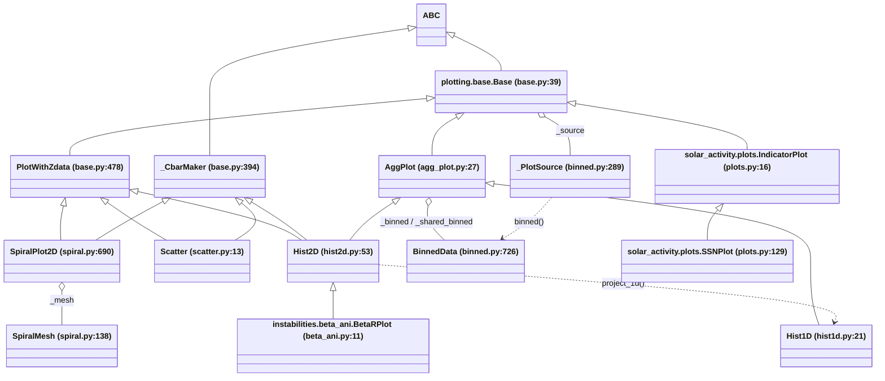
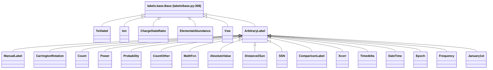

<!--
Spent-When: MARKED(<self>)
Supersedes: none
-->

# Architecture map: `solarwindpy/plotting/`

This is a read-only map, made so the author and Claude can design one class structure. It does not pick a design. Line numbers refer to the working tree as it stood when this map was written (HEAD `64379c6f`). Probes ran through `conda run -n solarwindpy python`, and each one was checked to import the working tree (`solarwindpy/__init__.py` in the repo). The probe scripts are in the session scratchpad.

Related findings in `docs/dispatches/findings-coherence-and-tooling-review-2026-11-04.md`:

- F118: two clipping percentile rules.
- F119 and F120: `clim` is copied.
- F121: the label-to-path rule is written three times.
- F122: `Hist1D.set_path` is a copy.
- F123: the path is stored, not derived.
- F124: `Scatter` takes a different constructor path.
- F125: parameter order differs.
- F126: `plot_contours` defaults differ.
- F127: `_nan_gaussian_filter` is a pass-through.
- F130: the label bracket form is written 14 times.
- Also relevant: F99/F100 (`FFPlot` copies `AxesLabels`/`LogAxes`/`set_log`/`set_labels`), F114 (`BetaRPlot` lives in `instabilities`), F115 (dead `_use_style`), F116 (four classes named `Base`).

## Author's answers folded in

1. SpiralPlot exists to give resolution where data is dense, and to show structure and boundaries that a coarse average hides. The author has used Hist2D most because SpiralPlot used to be slow. Section C measures this: since `54f6e4c0`, SpiralPlot2D at 1e6 points went from 4.2 s to 0.2 s.
2. The author calls plots directly and never through Plasma shortcuts. Section B shows that none exist.
3. Save paths are "maybe" still needed. When they are, they should describe the plot (x/y/z, log flags) and be derived rather than stored. Section 5 lists every place a path is built.
4. Plot objects are self-contained analysis chunks. They own their data and their binned results, and their methods return the matplotlib handles needed to act on the plot. Section A checks each method's return value against that.

---

## 1. Class hierarchy

Plot classes, with their external dependents. `BetaRPlot`, `IndicatorPlot` and `SSNPlot` live outside `plotting/`, but they inherit from it, so a restructure of `Base` reaches them.



These are the MROs as probed:

- `Hist1D`: `Hist1D, AggPlot, Base`.
- `Hist2D`: `Hist2D, PlotWithZdata, _CbarMaker, AggPlot, Base`.
- `Scatter`: `Scatter, PlotWithZdata, Base, _CbarMaker`.
- `SpiralPlot2D`: `SpiralPlot2D, PlotWithZdata, Base, _CbarMaker`.

`SpiralMesh`, `_PlotSource` and `BinnedData` subclass only `object`. `FFPlot` (`fitfunctions/plots.py:71`) is a parallel plotter that inherits nothing from `plotting`. It carries its own `AxesLabels`/`LogAxes`/`set_log`/`set_labels` (F99, F100) and a derived `path` property (see section 5).

Label classes (`plotting/labels/`). Each one has a `.path` that feeds the plot save path.



Where the label classes live:

- `TeXlabel`, `Base`: `labels/base.py`.
- `Ion`, `ChargeStateRatio`: `labels/composition.py`.
- `ElementalAbundance`: `labels/elemental_abundance.py`.
- `Timedelta`, `DateTime`, `Epoch`, `Frequency`, `January1st`: `labels/datetime.py`.
- Everything else: `labels/special.py`.

The plotting `Base` and the labels `Base` are different classes with the same name (F116).

Structural observations:

- `Hist2D` gets binning from `AggPlot` and z/alim/path from `PlotWithZdata`. `SpiralPlot2D` gets only the second, so it rebuilds binning and aggregation itself.
- `Hist1D` is the only binned plot without `PlotWithZdata`. So it has no `alim`/`set_alim`, and it has its own `_set_data` and `set_path`.
- `IndicatorPlot.__init__` (`solar_activity/plots.py:29`) never calls `Base.__init__`. I verified that it therefore skips `_init_logger`: on a minimal subclass, `.logger` and `.path` both raise `AttributeError`. It also skips the initial `set_path("auto")`, and only gets a path when a subclass calls `set_labels`, as `SSNPlot` does.

## 2. Responsibility matrix

Each cell says where the job lives for that class. **own** means the class implements the job itself, **inh** means it inherits it, and a dash means the class does not do the job. **DUP** marks a re-implementation that does the same job as a sibling's.

| Class | Data intake & alignment | Binning (cut / IntervalIndex) | Aggregation (groupby/agg) | axnorm | Log handling | clim | Labels | Path | Drawing | Colorbar |
|---|---|---|---|---|---|---|---|---|---|---|
| `_PlotSource` (binned.py:289) | **own**: align, mask, NaN/inf/log0 rows, `counts` | builds a `BinnedData` (`binned()` :493) | - | - | **own**: logs on read (`logged` :471, `materialize` :515) | - | - | - | - | - |
| `BinnedData` (binned.py:726) | own (frame, mask) | **own**: edges, intervals, int codes; clip at bin time | - | - | own (`log_of`) | - | - | - | - | - |
| `Base` (base.py:39) | abstract `_set_data`, `_claim_data` :373, `clip` :93-144 | - | - | - | **own** `set_log` :161, `_set_axis_scale` :346 | - | **own** `set_labels` :239, `_add_axis_labels` :333 | **own** abstract `set_path` :272 (x/y/z rule written 3 times, F121) | `_format_axis` :358 | - |
| `_CbarMaker` (base.py:394) | - | - | - | - | - | - | reads `labels.z` | - | - | **own** `_make_cbar` :435, `_prepare_cbar_kwargs` :398 |
| `PlotWithZdata` (base.py:478) | **own** `_set_data(x,y,z)` :580 | - | - | - | `_log_data` flag :484 | alim (`set_alim` :496, `_apply_alim` :542) | `set_labels` z :660 | **own** `set_path` :631 | - | - |
| `AggPlot` (agg_plot.py:27) | `_inherit` from BinnedData :186 | **own** `calc_bins_intervals` :260, `_nbins_by_axis` :482, `_finite_by_axis` :383, `make_cut` :533 | **own** `agg` :590, `_grouped_by_bin` :559, fcn default :613 | `_validate_axnorm` :730, `_divide_by_max` :139, `_bin_widths` :119 | inh | **own** `set_clim` :156, filter :618-627 | inh | inh (abstract) | - | - |
| `Hist1D` (hist1d.py:21) | **DUP** `_set_data` :137 (same body as `base.py:580`, coords `{x}`, value `y`) | inh | inh, plus a d/fcn check :248 | **own** x-only `_axis_normalizer` :227; `set_axnorm` :163 with **DUP** Count rebuild :174-177 (`hist2d.py:188-191`) | inh; `10**` at :219, :337 | inh | own :256, with **DUP** Count rebuild :260-263 (`hist2d.py:162-169`) | **DUP** `set_path` :118 (F122) | own `errorbar`/`fill_between` :267 | - |
| `Hist2D` (hist2d.py:53) | inh (PlotWithZdata) | inh | inh, plus `_apply_alim` :240 | **own** c/r/t/d/cd/rd :195, `_default_norm` :250, `_get_contour_levels` :664 | inh; `_maybe_convert_to_log_scale` :152, `10**` again at :603-606 | inh | own :160 | inh | own `pcolormesh` :367, contour :816, :531, edges :577 | `_make_cbar` tick override :242 |
| `Scatter` (scatter.py:13) | inh | - | - | - | **bypasses** `set_log` (assigns `_log` :41, F124); `_log_data` False | - (alim only, on z) | **bypasses** `set_labels` (assigns `_labels` :40) | **bypasses**: `set_path(None)` :42 (F124) | own `ax.scatter` :95; **DUP** sticky edges :53-58 (`spiral.py:1038-1046`) | inh |
| `SpiralMesh` (spiral.py:138) | own `set_data` :270 | **own** adaptive mesh: `initialize_bins` :281, `generate_mesh` :364, `_refine_by_descent` :516, `_refine_by_counting` :477, `calculate_bin_number` :614, `build_cat` :676 | - | `cell_filter` :202 (area dA and density) | none (receives logged x, y) | - | - | - | - | - |
| `SpiralPlot2D` (spiral.py:690) | inh (PlotWithZdata), refuses BinnedData :746 | **own** `calc_initial_bins` :838, with **DUP** nbins parsing :859-869 (`agg_plot.py:482-511`) and finite filter :874 (`agg_plot.py:383-409`); clip applied in `initialize_mesh` :916-919 | **own** `agg` :784, `build_grouped` :818; **DUP** fcn default :792 (`agg_plot.py:613`); **DUP** clim filter :798-808 (F120) | **none**: no `axnorm`, no `set_axnorm` | inh; `10**` at :991-994, :1309-1312 | **DUP** `set_clim` :932, returns `RangeLimits` rather than a tuple (F119) | inh (`Count()` built without norm :757) | inh | own `PolyCollection` :1020, contours :1161 | inh (`_make_cbar(norm=...)`) |
| `BetaRPlot` (beta_ani.py:11) | inh | inh | inh | inh | defaults logx/logy True | `set_clim(5)` | `TeXlabel` | re-calls `set_path("auto")` :77 | inh, with `cmap` default | inh |
| `IndicatorPlot` (solar_activity/plots.py:16) | own | - | - | - | `set_log` | - | assigns `_labels` directly :33 | **DUP** `set_path` :75 (third copy of the subclass suffix logic) | own `ax.plot` | - |

Duplicated jobs that are not in the matrix columns:

- **Smoothing branch (gaussian filter, NaN-aware or not), four copies**: `hist1d.py:340-349`, `hist2d.py:486-501`, `hist2d.py:784-795`, `spiral.py:1353-1361`. There are also two call forms for `nan_gaussian_filter` (F127).
- **Default contour linestyles, three copies**: `hist2d.py:512-524`, `hist2d.py:754-766`, `spiral.py:1284-1296`. They do not agree: the last tuple at `hist2d.py:522` is `(0, (7, 3, 1, 3))`, and the other two end `(0, (7, 3, 1, 3, 1, 3))`.
- **Contour dispatch** (`contour` or `contourf`, the `levels`-or-not argument list): `hist2d.py:509/526-533`, `hist2d.py:807-816`, `spiral.py:1323-1330`, `spiral.py:1367-1374`.
- **`alpha_fcn` transparency block**: `hist2d.py:380-403` and `spiral.py:1057-1074`. They share the `alpha**0.25` and `plt.draw()` code, but Hist2D warns and skips this for count plots, and Spiral does not.
- **`ax is None -> plt.subplots()`**: written in every drawing method (`hist1d.py:334`, `hist2d.py:358/461/768`, `scatter.py:80`, `spiral.py:982/1298`).
- **Axis formatting**: `IndicatorPlot._format_axis` (`solar_activity/plots.py:36-49`) re-implements `Base._add_axis_labels` and `_set_axis_scale` (`base.py:333-356`).
- **Clipping applied at three different points**: when binning (inside `BinnedData` via `_PlotSource.binned`), in `SpiralPlot2D.initialize_mesh` (`spiral.py:916-919`), and in `Scatter.make_plot` (`scatter.py:84-86`). The rule itself is shared (`Base.clip_data` calls `_clip_to_quantiles`), but where it is applied is not.
- **axnorm stored twice**: as `plot._axnorm` and as the `Count` label's `_axnorm`. The two are kept in step by hand in `set_axnorm` and `set_labels` (Hist1D and Hist2D each), and are not kept in step at all in SpiralPlot2D.

## 3. Pipelines

**Hist1D** (`hist1d.py:33`):

1. `Base.__init__`: logger; default labels `x`/`y`; `set_path("auto")` before any data exists.
2. `_inherit(nbins, ...)` resolves `logx`/`clip`, taking them from a shared `BinnedData` if there is one.
3. `set_log`, then `set_axnorm`. At this point the y label is still the string `"y"`, so the Count rebuild does nothing.
4. `_set_data`: a `_PlotSource({"x"}, "y")` keeps rows with no NaN/inf/log0 that pass `mask` and `within`, and decides `counts`.
5. `set_labels(y=Count(norm=axnorm))`, which re-derives the path.
6. `calc_bins_intervals` builds one `IntervalIndex` from count, rule, knuth, edges, IntervalIndex or BinnedData.
7. `make_cut` creates a private `BinnedData` holding int codes.
8. `set_clim(None, None)`.
9. `make_plot`: `agg` groups by code, aggregates, applies clim, sets the axis to the grid, applies `_axis_normalizer` (d or t), and reindexes to the full grid. The x positions are `index.mid`, and `10**` is applied if logx. Then optional smoothing, `errorbar` or `fill_between`, and `_format_axis`.

**Hist2D** (`hist2d.py:111`):

1. The same as Hist1D steps 1 to 2 for x and y.
2. `set_log`.
3. `PlotWithZdata._set_data`: a `_PlotSource({"x","y"}, "z", log=...)` whose x and y are stored for reading as `log10|.|`.
4. `set_labels(z=Count(norm=axnorm))`.
5. `set_axnorm`. This order is the reverse of Hist1D's.
6. `calc_bins_intervals`, then `make_cut`, then `set_clim`. All of this is done in the constructor.
7. `make_plot`: `agg` builds flat codes `ix * ny + iy`, then runs groupby, clim, product-grid `MultiIndex`, `_axis_normalizer`, `reindex`, and `_apply_alim`. Then `unstack("x")`, then the `edges`, with `10**` applied if log. Then the default norm from axnorm, `pcolormesh(meshgrid)`, the colorbar with axnorm ticks, `_format_axis`, and optionally `alpha_fcn`.

**Scatter** (`scatter.py:18`):

1. `Base.__init__`, which already calls `set_path("auto")`.
2. `_set_data(x, y, z)`. x and y are never logged (`_log_data` is False).
3. `_labels` and `_log` are assigned directly, and `set_path(None)` replaces the path with a bare scale (F124).
4. `make_plot`: `data` is materialized, each column is clipped per `clip`, rows outside `alim` on z are dropped, `c=z` is used only if z has more than one value, then `ax.scatter`, the colorbar, and `_format_axis`. The log scale is applied only to the drawing.

**SpiralPlot2D** (`spiral.py:704`):

1. It refuses a `BinnedData`.
2. `Base.__init__`.
3. `set_log`.
4. `_set_data`, the same as Hist2D's.
5. `set_labels(z=Count())`. There is no axnorm.
6. `calc_initial_bins`: per-axis int (quantile edges) or ndarray; the top edge is padded by 1%.
7. `set_clim`.
8. The constructor stops here. The **caller must then call** `initialize_mesh(min_per_bin=...)`. That call clips x and y, builds `SpiralMesh(x, y, edges)`, runs `generate_mesh` (splitting into quarters by descent until no cell holds more than `min_per_bin` points), then `calculate_bin_number` and `build_cat`.
9. The caller must then call `build_grouped()`, which stores `z.groupby(cat)`.
10. `make_plot`: `agg` runs groupby, clim, `reindex(RangeIndex(n_cells))`, `cell_filter`, and `_apply_alim`. Then `10**` on the cell edges, the corner vertices go into one `PolyCollection`, it is autoscaled, the colorbar is drawn, `_format_axis` runs, and optionally `alpha_fcn`.

### Where the adaptive mesh departs from the fixed grid

**Genuinely different.** These are properties of the mesh itself.

- **Mesh construction.** The fixed grid is a product of 1-D edges chosen before the data is placed (count, rule, given). The mesh is built from the data: start from quantile edges, then split each cell holding more than `min_per_bin` points into quarters, recursively (`spiral.py:516`). It cannot be shared across plots, which is why it refuses `BinnedData` (`spiral.py:746`).
- **Cell geometry.** Fixed-grid cells are `IntervalIndex` pairs, and the aggregation index is a `MultiIndex` of intervals. Mesh cells are rows `[x0, x1, y0, y1]` of an (N, 4) array, and the aggregation index is a `RangeIndex`. Fixed-grid closure depends on the `nbins` type (left-closed for an int, right-closed otherwise). Mesh cells are always half-open `[x0, x1)`, with the top edge padded to hold the maximum.
- **No rows or columns.** This is why `c`, `r`, `cd` and `rd` have no meaning on the mesh. Only `t` (divide by the maximum) and `d` (divide by N times the cell measure) carry over. The measure is `dx*dy` from `_bin_widths` on the grid, and `dA` already computed in `SpiralMesh.cell_filter` (`spiral.py:220-222`) on the mesh.
- **Methods that need the product grid, which stay fixed-grid only**: `project_1d`, `make_joint_h2_h1_plot`, `get_border`, `plot_edges`, `id_data_above_contour`, `take_data_in_yrange_across_x`, `cut`, `joint`, `intervals`, `edges`, and BinnedData sharing.
- **Cell quality filter.** `cell_filter` drops cells by area quantile and density quantile, and has no fixed-grid counterpart.
- **Contours.** On the grid, contours draw from bin centers on a regular mesh. On the mesh, scattered cell centers have to be interpolated first (RBF, griddata, or tricontour, `spiral.py:1078-1159`).
- **Drawing.** `pcolormesh` on a meshgrid, against a `PolyCollection` of vertices.

**The same job done differently.**

- **Aggregation.** Both group z by an integer cell code and fill in a full index: flat code `ix * ny + iy` (`agg_plot.py:559-581`) against the mesh category (`spiral.py:835`). The `fcn` default and the clim filter are line-for-line copies (F120).
- **Normalization.** It is missing on the mesh, not different. `t` and `d` could share an implementation through a "cell measure" hook.
- **clim.** Two setters, two storage types (F119).
- **Labels.** The z `Count` label is built with axnorm on the grid and without it on the mesh.
- **Paths.** Both inherit `PlotWithZdata.set_path` and give the same shape (`SpiralPlot2D/x/y/count/linX-linY`). They differ only because Spiral has no norm suffix.
- **Lifecycle.** Hist2D bins in its constructor. Spiral needs two more calls. Spiral's `grouped` is stored, while AggPlot's `grouped` is a computed property.
- **Initial binning.** `calc_initial_bins` and `calc_bins_intervals` do the same parsing of int or per-axis specs and the same finite filtering, under different names.
- **Clip.** Applied at mesh time instead of at bin time.
- **Log.** Identical (`_log_data = True`). Each class back-converts with its own `10**`.

## 4. Setter and getter inventory

Signatures are probed with `inspect.signature`. **Owner** is the class that defines the method or property in the MRO. A dash means the class does not have it.

| Name | Hist1D | Hist2D | Scatter | SpiralPlot2D | Owner / note |
|---|---|---|---|---|---|
| `set_log(x=None, y=None)` | yes | yes | yes, but its constructor bypasses it | yes | Base. Raises if a built data axis would change. |
| `set_labels(**kwargs)` (x, y, z, auto_update_path) | Hist1D: rejects z, rebuilds Count | Hist2D: rebuilds Count | PlotWithZdata | PlotWithZdata | Base. Re-derives the path when `auto_update_path` is True. |
| `set_path(new, add_scale=True)` | Hist1D (copy) | PlotWithZdata | PlotWithZdata | PlotWithZdata | Base is abstract with `add_scale=False`, so the default differs from every override. |
| `set_clim(lower=None, upper=None)` | AggPlot, tuple | AggPlot, tuple | - | SpiralPlot2D, `RangeLimits` | F119 |
| `set_axnorm(new)` | Hist1D, `{d, t}` | Hist2D, `{c, r, t, d, cd, rd}` | - | - | abstract in AggPlot |
| `set_alim(lower=None, upper=None, kind='value')` | - | yes | yes (on z) | yes | PlotWithZdata |
| `calc_bins_intervals(nbins=101, precision=None)` | yes | yes | - | - | AggPlot |
| `calc_initial_bins(nbins)` | - | - | - | yes | SpiralPlot2D (same job as above) |
| `make_cut()` | yes | yes | - | - | AggPlot |
| `initialize_mesh(*, progress=True, **kwargs)` | - | - | - | yes | SpiralPlot2D (same stage as `make_cut`) |
| `build_grouped()` | - | - | - | yes | SpiralPlot2D |
| `agg(...)` | `agg(**kwargs)` | `agg(**kwargs)` | - | `agg(fcn=None)` (no kwargs pass-through) | |
| prop `data`, `clip`, `log`, `labels`, `path`, `logger` | yes | yes | yes | yes | Base |
| prop `alim`, `alim_kind` | - | yes | yes | yes | PlotWithZdata |
| prop `clim` | yes | yes | - | yes (own) | |
| prop `axnorm` | yes | yes | - | - | AggPlot |
| prop `edges`, `intervals`, `categoricals`, `cut`, `agg_axes`, `joint`, `grouped` | yes | yes | - | `grouped` only (stored) | AggPlot |
| prop `initial_bins`, `mesh` | - | - | - | yes | SpiralPlot2D |

`SpiralMesh` (spiral.py:138) has its own **public** setters, with no getter/setter pattern shared with the plots:

- setters: `set_data(x, y)`, `set_min_per_bin(new)`, `set_initial_edges(xedges, yedges)`, `set_cell_filter_thresholds(**kwargs)` (density, size).
- properties: `bin_id`, `cat`, `data`, `initial_edges`, `mesh`, `min_per_bin`, `cell_filter_thresholds`, `cell_filter`.

`set_data` here is public and can be called again, while the plots set data once (`_claim_data`). The only way a caller sets `cell_filter_thresholds` is `plot.mesh.set_cell_filter_thresholds(...)`.

Constructor signatures (F125). The author's stated standard order is variables, log axis, axnorm.

- `Hist1D(x, y=None, logx=None, axnorm=None, clip=None, nbins=101, bin_precision=None, mask=None)`: matches the standard.
- `Hist2D(x, y, z=None, axnorm=None, logx=None, logy=None, clip=None, nbins=101, bin_precision=None, mask=None)`: axnorm comes **before** log.
- `Scatter(x, y, z=None, clip=None, mask=None)`: no logx/logy.
- `SpiralPlot2D(x, y, z=None, logx=None, logy=None, initial_bins=5, clip=None, mask=None)`: no axnorm. It is called `initial_bins`, not `nbins`.
- `BetaRPlot(beta, ani, species, **kwargs)`.

## 5. Path building

Every place a path is built or stored:

| Site | Builds or stores | Depends on |
|---|---|---|
| `Base.__init__` `base.py:61` | calls `set_path("auto")` before data, log or labels are final | class name, default labels, default log |
| `Base.set_path` `base.py:272-331` | returns `(Path(cls), x, y, z, scale_info)`. The label-to-part rule is written 3 times (F121). | `labels.{x,y,z}.path`, or the string with spaces replaced by `-`, or the axis letter; `log.x`/`log.y` |
| `PlotWithZdata.set_path` `base.py:631-656` | **stores** `self._path = cls/x/y/z/<linX-linY>`; if the last part ends in `norm`, the scale goes before it (`.../count/linX-linY-Tnorm`) | the above, plus axnorm through the `Count` label path `count/Tnorm` (`labels/special.py:335-342`) |
| `Hist1D.set_path` `hist1d.py:118-133` | **stores** `cls/x/y/<linX>`, with no y scale and no norm special case, so it gives `Hist1D/x/count/Tnorm/linX` (F122) | x/y labels, `log.x` only |
| `Base.set_labels` `base.py:268` | re-derives the path whenever labels change (`auto_update_path=True`) | as above |
| `Scatter.__init__` `scatter.py:42` | `set_path(None)` gives the bare `linX-linY` (F124) | log only |
| `BetaRPlot.__init__` `beta_ani.py:77` | re-calls `set_path("auto")` after its labels | TeXlabel paths, log |
| `IndicatorPlot.set_path` `solar_activity/plots.py:75` | **stores** `cls/x/y/<linX-linY>` (another copy of the suffix logic) | labels, log |
| `TeXlabel.path`, `Count.path` and the other label classes | each label's own `_path`, set in `build_label` (e.g. `labels/base.py:620` appends `<AXNORM>norm`) | label content, axnorm |
| `FFPlot.path` `fitfunctions/plots.py:128` | a **derived property**, computed on every read: `cls/fitfunction/x/y[/z]/<logX_linY>` | labels, log. This is an in-repo example of the "derived, not stored" pattern; it joins the scales with `_`, while the plot classes join them with `-`. |
| `tools.save(fig, spath, ...)` `tools.py:72` | consumes a `Path` and writes `.pdf`/`.png` | caller passes `plot.path` or any path |

Staleness, all verified by probe:

- `Hist2D` then `set_axnorm("c")`: the path stays `Hist2D/x/y/count/linX-linY` while `labels.z.path` is `count/Cnorm`. Only an explicit `set_path("auto")` gives `.../linX-linY-Cnorm`.
- `Hist1D` then `set_log(y=True)`: the path is `Hist1D/x/count/linX` before and after `set_path("auto")` (F122).
- `Scatter` then `set_log(x=True, y=True)`: the path is `linX-linY` (F123). After `set_path("auto")` it becomes `Scatter/x/y/z/logX-logY`, which contains a literal `z` even when no z was given.
- `set_log` never refreshes the path. `set_labels` does. `set_axnorm` does not.

What a derived path depends on, as a single function: the class name, `labels.x/y/z` (each label's `.path` or its string), `log` (per axis), and `axnorm`. axnorm currently arrives only through the `Count` label, so a non-Count z label with an axnorm has no norm in its path. Spiral would add nothing, unless `min_per_bin` or `initial_bins` should appear in it (question Q5).

## 6. Candidate structures

The working proposal from the author: the adaptive mesh becomes a binning strategy beside the fixed grid, and aggregation, normalization, clim, labels, colorbar and derived paths are shared.

**Fit check against the code.** The proposal fits the aggregation core.

- Both binned plots reduce to "integer cell code per kept row, -1 outside, then `groupby(code)`, then the full cell index". `AggPlot._grouped_by_bin` (`agg_plot.py:559`) already works on flat ints, and Spiral's `cat` is flat ints. The clim, fcn default and alim steps are identical.
- The proposal fits less well in three places.
  - The aggregation **index type** differs: an interval `MultiIndex` against a `RangeIndex`. Every consumer of a product grid (`project_1d`, `get_border`, contours on `unstack`) would have to stay specific to the fixed grid.
  - **axnorm** is only partly shared. `t` and `d` can be shared through a cell-measure hook, but `c`, `r`, `cd` and `rd` need rows and columns. The strategy would have to declare which axnorms it supports. `_validate_axnorm(new, allowed)` already takes that list.
  - The **lifecycle**: Spiral defers mesh building to `initialize_mesh(min_per_bin=...)`. With the mesh as a binning strategy, it would be built in the constructor, which needs `min_per_bin` as a constructor argument (Q3). With the mesh now at 0.2 s for 1e6 points (section C), cost no longer forces the deferral.
- Hist1D is a 1-D fixed grid with the same aggregation. Scatter has no binning and shares only data, labels, log, path and colorbar.

### Candidate A: inheritance with a pluggable Binning strategy

```
Plot(ABC)                    data via _PlotSource, log, clip, labels, derived `path` property,
                             _format_axis, _new_ax(); set_log/set_labels; abstract make_plot
ColorPlot(Plot)              z label, alim, _make_cbar, return-handle convention
Binning(ABC)                 assign(source, clip) -> int codes; n_cells; index(); cell_measure();
                             cell_geometry(); allowed_axnorm; postfilter(agg) (identity default)
FixedGrid(Binning)           wraps BinnedData; 1-D or 2-D; index = IntervalIndex / product MultiIndex;
                             measure = bin widths; allowed = d,t (1-D), c,r,t,d,cd,rd (2-D)
AdaptiveMesh(Binning)        wraps SpiralMesh; index = RangeIndex; measure = dA; allowed = t,d;
                             postfilter = cell_filter
BinnedPlot(Plot)             holds a Binning; agg (fcn default, clim, axnorm via measure, alim);
                             set_clim, set_axnorm, get_plotted_data_boolean_series
Hist1D(BinnedPlot)           FixedGrid 1-D; errorbar / window drawing; construct_cdf
Hist2D(BinnedPlot,ColorPlot) FixedGrid 2-D; pcolormesh, contours, project_1d, edges, selections
SpiralPlot2D(BinnedPlot,ColorPlot)  AdaptiveMesh; PolyCollection, interpolated contours
Scatter(ColorPlot)           no Binning; scatter drawing
```

- **What moves.**
  - `AggPlot.agg`/`_grouped_by_bin`/`set_clim` go to `BinnedPlot`, and Spiral's copies (`spiral.py:784-816`, `:932`) are deleted.
  - `calc_bins_intervals`/`make_cut` go into `FixedGrid`.
  - `calc_initial_bins`/`initialize_mesh`/`build_grouped` go into `AdaptiveMesh`.
  - `set_path` becomes one derived property on `Plot`, replacing the four overrides (`base.py:272/631`, `hist1d.py:118`, `solar_activity/plots.py:75`).
  - The Count-label rebuild moves to one place in `BinnedPlot.set_axnorm`.
  - `_divide_by_max` and the density formula use `cell_measure`.
  - The smoothing, linestyle, contour-dispatch and alpha blocks become `ColorPlot` helpers.
- **What stays.** `SpiralMesh` and its numba/descent code, `BinnedData`, `_PlotSource`, the labels package, and all Hist2D-only selection and projection methods.
- **Public names that change.**
  - `AggPlot` and `PlotWithZdata` are replaced (no test constructs either directly).
  - `set_path`/`add_scale` would go (or `set_path` stays as an override slot).
  - Spiral's `initialize_mesh`/`build_grouped`/`calc_initial_bins` become internal, and `min_per_bin` moves to the constructor.
  - Spiral gains `axnorm`/`set_axnorm` (t, d).
  - `SpiralPlot2D.clim` becomes a tuple, or both become `RangeLimits`.
  - Hist2D's argument order changes if aligned to the standard order.
  - `BetaRPlot` and `IndicatorPlot` re-base.

### Candidate B: composition

```
DataSource                   = today's _PlotSource (alignment, mask, log on read, counts)
Binner (protocol)            codes(), index(), measure(), geometry(), allowed_axnorm, postfilter
  GridBinner                 BinnedData-backed; shareable through nbins
  MeshBinner                 SpiralMesh-backed; built from its own DataSource
Aggregator                   fcn default, clim, axnorm(measure), alim -> Series on binner.index()
PathSpec                     pure function (cls, labels, log, axnorm) -> Path; read on access
Renderer (protocol)          draw(ax, agg, binner) -> handles
  LineRenderer, MeshRenderer(pcolormesh), PolyRenderer, ContourRenderer(grid|interp), PointRenderer
Hist1D / Hist2D / SpiralPlot2D / Scatter   thin facades: build the pieces in __init__,
                             expose today's setters/properties by delegation, return Renderer handles
```

- **What moves.**
  - Binning, aggregation, normalization and clim leave the class tree entirely. The facades keep the public names and delegate, for example `Hist2D.agg()` returns `self._agg.run(...)`.
  - Drawing code moves out of `make_plot` bodies into renderers, so pcolormesh against PolyCollection, and grid contours against interpolated contours, become choices of renderer.
  - The contour code shared by Hist2D and Spiral (`hist2d.py:694` and `spiral.py:1161`) becomes one `ContourRenderer` with a grid or interpolated source. This would force a decision on the F126 defaults.
- **What stays.** The public class names and constructor entry points, `BinnedData` (it is already a composable binner), `_PlotSource` (it is already the DataSource), `SpiralMesh`, and the labels package.
- **Public names that change.** The facades could keep every current setter and getter, but `AggPlot`/`PlotWithZdata`/`_CbarMaker` disappear as bases. `BetaRPlot(Hist2D)` still works if `Hist2D` stays subclassable, but `IndicatorPlot(base.Base)` needs a new base. Spiral's extra lifecycle calls and the clim type change as in A. The return tuples are fixed by the Renderer contract (section A).

### Test blast radius (both candidates)

These counts are an AST walk over `tests/plotting`. They count functions, fixtures and helpers included, that contain a direct call to the class name. They are **lower bounds**: parametrized builders such as `cls(x, y)` are not counted.

| Class | direct calls | functions containing one | files |
|---|---|---|---|
| `Hist1D` | 139 | 129 | 11 |
| `Hist2D` | 147 | 137 | 12 |
| `Scatter` | 45 | 38 | 7 |
| `SpiralPlot2D` | 34 | 30 | 7 |
| `SpiralMesh` | 9 | 9 | 2 |
| `BetaRPlot` | 7 | 5 | 2 |
| `BinnedData` | 54 | 52 | 5 |
| `AggPlot`, `PlotWithZdata` | 0 | 0 | 0 |

Across all of `tests/`, the extra hits are Scatter 47/40/8 and BetaRPlot 11/9/3.

`tests/plotting` collects 3850 items, and `test_plot_invariants.py` alone collects 2280. The invariants file parametrizes over the classes; counting node ids by class gives Hist2D 799, BetaRPlot 799, Hist1D 622, SpiralPlot2D 45, Scatter 12. Those tests construct plots through builders (`test_plot_invariants.py:158-193`), so a constructor-signature change there is one edit that covers many items.

Test functions that touch the surfaces each candidate changes (functions under `tests/plotting/test_*.py`):

- `agg`: 125
- `set_axnorm`: 41
- `edges`: 32
- `mesh`: 20
- `set_labels`: 18
- `set_alim`: 17
- `intervals`: 15
- `set_clim`: 12
- `initialize_mesh`: 10
- `initial_bins`: 9
- `set_log`: 9
- `path`: 7
- `build_grouped`: 5
- `set_path`: 4

A derived path breaks the hand-written expected paths in `tests/plotting/test_base.py:331-402` first. Moving Spiral's lifecycle into the constructor touches the 10 `initialize_mesh` and 5 `build_grouped` functions.

## A. Return-value inventory

Each entry gives the exact return expression, from an AST of the `return` statements.

| Method | Returns | Notes |
|---|---|---|
| `Hist1D.make_plot` hist1d.py:267 | `(ax, out)` | `out` is an `ErrorbarContainer`, or `(line, polycol)` with `plot_window`. No colorbar slot. |
| `Hist2D.make_plot` hist2d.py:317 | `(ax, cbar_or_mappable)` | the colorbar if `cbar=True`, else the `QuadMesh`. **With `cbar=True` the QuadMesh is not returned.** |
| `Hist2D.plot_hist_with_contours` :407 | `(ax, cbar_or_mappable, qset)` | the colorbar is of the pcolormesh |
| `Hist2D.plot_contours` :694 | `(ax, cbar_or_mappable, qset)` | edges drawn by `plot_edges` are **not returned** |
| `Hist2D.plot_edges` :626 | `(etop, ebottom)` | no `ax` |
| `Hist2D.make_joint_h2_h1_plot` :928 | `(hax, xax, yax, cbar)` | the mesh and the 1-D artists are not returned |
| `Scatter.make_plot` scatter.py:60 | `(ax, cbar)` | `cbar` is None when there is no z or `cbar=False`. **The `PathCollection` is never returned.** |
| `SpiralPlot2D.make_plot` spiral.py:941 | `(ax, cbar_or_mappable)` | the same conflation as Hist2D (`PolyCollection` lost when `cbar=True`) |
| `SpiralPlot2D.plot_contours` :1161 | `(ax, cbar_or_mappable, qset)` | |
| `BetaRPlot.make_plot` beta_ani.py:80 | `(ax, cbar)` | passes Hist2D's value through, so it is actually `cbar_or_mappable` |
| `IndicatorPlot.make_plot` / `SSNPlot` solar_activity/plots.py:111 | **nothing** | |
| `StabilityContours.plot_contours` instabilities/verscharen2016.py:456 | **nothing** | |
| `SIDC.plot_on_colorbar` sunspot_number/sidc.py:514 | **nothing** | |
| `FFPlot.plot_raw` / `plot_used` fitfunctions/plots.py:319/350 | `(ax, plotted)` or `(ax, (line, window, edges))` | via `_plot_observations` :267 |
| `FFPlot.plot_fit`, `plot_raw_used_fit`, `plot_residuals` | `ax` | |
| `FFPlot.plot_raw_used_fit_resid` | `(hax, rax)` | |

There is no `plot_sns` and no `plot_hist` anywhere in `solarwindpy/`: `git grep -n 'def plot_hist\b\|def plot_sns' -- solarwindpy` returns nothing, and the only near match is `Hist2D.plot_hist_with_contours`. No method returns contour labels: `git grep clabel -- solarwindpy` is empty, because Spiral's labelling was removed in `fa0e9784` "to match Hist2D".

**Against a fixed handle order such as `(ax, artist, cbar_or_None[, qset])`:**

- Hist2D, Spiral and BetaRPlot's `make_plot` return the colorbar *or* the artist, never both.
- Scatter never returns its artist.
- Hist1D has no colorbar slot, and its artist is a container or a tuple.
- Contour methods return `qset` but not the mappable or edge artists.
- Three methods return nothing: `IndicatorPlot.make_plot` (and so `SSNPlot`), `StabilityContours.plot_contours` and `SIDC.plot_on_colorbar`.

Every current `make_plot` would change its return shape, and so would every caller that unpacks two values. The second position currently means two different things depending on `cbar`.

## B. Plasma or core plot shortcuts

**None exist.**

- The proof is `git grep -wn -e Hist1D -e Hist2D -e Scatter -e SpiralPlot2D -e BetaRPlot -e AggPlot -e SSNPlot -e IndicatorPlot -e SpiralMesh -- solarwindpy ':!solarwindpy/plotting' ':!solarwindpy/instabilities/beta_ani.py' ':!solarwindpy/solar_activity/plots.py'`. It returns no lines.
- The positive control is the same grep restricted to the two excluded files. It returns `beta_ani.py:10` and `solar_activity/plots.py:9` matching lines.
- `git grep -nE 'plotting|instabilities|solar_activity|matplotlib' -- solarwindpy/core solarwindpy/tools solarwindpy/__init__.py` finds no import of plotting or matplotlib in `core/` or `tools/`. The only hits are in `solarwindpy/__init__.py`.
- The only thing resembling a shortcut is the namespace alias `pp = plotting` (`solarwindpy/__init__.py:62`). Its comment calls it temporary "until the author's analysis code migrates to `solarwindpy.plotting`". It is an alias, not a plot constructor.

A pitfall from this check: the first form of the grep used `\b` under `git grep -E`, and then a zsh variable that was not word-split. Both returned zero lines **for the control as well**, so the patterns above are written out literally.

## C. Speed

The acceleration commit is `54f6e4c0`, "perf(plotting): faster binning and Spiral mesh; draw Spiral as one PolyCollection" (2026-11-03). It made three changes:

- `generate_mesh` places each point in its initial cell once and moves only the points of overfull cells down the tree (`_refine_by_descent`, `spiral.py:516`). `calculate_bin_number` reuses that placement.
- `make_plot` draws one `PolyCollection` instead of one `Rectangle` per cell.
- Hist binning is faster.

The other spiral commits matching numba, speed or vectorize are correctness fixes or refactors (`c69e663e`, `3320a6a6`, `8fdf65dd`). I infer from its subject alone that `887eba88` is where numba was added as a dependency. On the descent path numba is not called: its kernels remain only in the counting fallback, used for unsorted or non-finite edges, and in `calculate_bin_number` when the mesh did not place the points.

Synthetic data: `x ~ N(400, 80)`, `y = 0.5x + N(0, 30)`, `z ~ lognormal`, aggregated as the mean of z. Hist2D uses `nbins=101`. Spiral uses `initial_bins=5`. Each figure is the best of 3, after a 1e4 warmup run, on macOS with the Agg backend.

**Current tree, by stage** (script 1). The build column is the constructor (bins and cut). Draw is `make_plot` plus `canvas.draw()`.

| n | plot | total | build | mesh | agg | draw | non-NaN cells |
|---|---|---|---|---|---|---|---|
| 1e5 | Hist2D | 0.03 s | 0.00 | - | 0.00 | 0.02 | 2816 |
| 1e5 | Spiral, min_per_bin=250 | 0.04 s | 0.00 | 0.01 | 0.00 | 0.02 | 946 |
| 1e5 | Spiral, min_per_bin=25 | 0.05 s | 0.00 | 0.01 | 0.00 | 0.03 | 9126 |
| 1e6 | Hist2D | 0.06 s | 0.02 | - | 0.01 | 0.03 | 3438 |
| 1e6 | Spiral, min_per_bin=250 | 0.22 s | 0.03 | 0.14 | 0.01 | 0.04 | 9650 |
| 1e6 | Spiral, min_per_bin=25 | 0.41 s | 0.03 | 0.17 | 0.01 | 0.20 | 80103 |

**Before and after `54f6e4c0`** (script 2). The same script was run on both trees. The old tree was extracted with `git archive 54f6e4c0^ solarwindpy` into the scratchpad and put first on `sys.path` under `python -I`; the script prints which `solarwindpy/__init__.py` it imported. Spiral uses `min_per_bin=250`. The warmup took 1.01 s on the old tree, which was numba JIT compilation in the counting kernels, and 0.04 s on the current tree.

| n | tree | Hist2D build+agg | Spiral build+mesh+agg | Spiral draw | Spiral total |
|---|---|---|---|---|---|
| 1e5 | `54f6e4c0^` | 0.01 s | 0.03 s | 0.04 s | 0.07 s |
| 1e5 | current | 0.00 s | 0.01 s | 0.02 s | 0.03 s |
| 1e6 | `54f6e4c0^` | 0.11 s | 3.95 s | 0.27 s | 4.22 s |
| 1e6 | current | 0.03 s | 0.16 s | 0.04 s | 0.20 s |
| 1e7 | current | 0.29 s | 2.08 s | 0.25 s | 2.33 s |

At 1e6 points, Spiral went from 4.22 s to 0.20 s, about 21 times faster. It is now about 7 times slower than Hist2D on build plus aggregation at 1e6, and 2.3 s against 0.29 s at 1e7. I did not time anything earlier than `54f6e4c0^`, so these figures do not say how slow Spiral was when the author last used it regularly (Q13).

These timings come from synthetic data on one machine. Real data with heavy duplicates or fill values could reach the counting fallback, or the `_unsplittable` error. Neither was measured.

Script 1, exactly as run (`conda run -n solarwindpy python bench.py`):

```python
import time, logging, warnings, numpy as np, pandas as pd, matplotlib
matplotlib.use("Agg"); import matplotlib.pyplot as plt
warnings.filterwarnings("ignore"); logging.disable(logging.CRITICAL)
from solarwindpy.plotting.hist2d import Hist2D
from solarwindpy.plotting.spiral import SpiralPlot2D

def data(n, seed=0):
    r = np.random.default_rng(seed)
    x = r.normal(400, 80, n); y = 0.5*x + r.normal(0, 30, n); z = r.lognormal(0, 1, n)
    return pd.Series(x, name="x"), pd.Series(y, name="y"), pd.Series(z, name="z")

def t(f):
    s = time.perf_counter(); out = f(); return out, time.perf_counter() - s

def hist2d(x, y, z):
    h, tb = t(lambda: Hist2D(x, y, z, nbins=101))       # bins + cut
    a, ta = t(lambda: h.agg())                           # groupby + agg + norm
    fig, ax = plt.subplots()
    _, td = t(lambda: (h.make_plot(ax=ax), fig.canvas.draw()))
    plt.close(fig); return dict(build=tb, agg=ta, draw=td, cells=int(a.notna().sum()))

def spiral(x, y, z, mpb):
    s, tb = t(lambda: SpiralPlot2D(x, y, z, initial_bins=5))
    _, tm = t(lambda: s.initialize_mesh(progress=False, min_per_bin=mpb))
    _, tg = t(lambda: s.build_grouped())
    a, ta = t(lambda: s.agg())
    fig, ax = plt.subplots()
    _, td = t(lambda: (s.make_plot(ax=ax), fig.canvas.draw()))
    plt.close(fig); return dict(build=tb, mesh=tm, group=tg, agg=ta, draw=td, cells=int(a.notna().sum()))

x, y, z = data(10_000, 99)
_, w = t(lambda: spiral(x, y, z, 250)); print(f"warmup spiral 1e4 (numba JIT, first call) {w:.2f}s")
for n in (100_000, 1_000_000):
    x, y, z = data(n)
    for name, f in (("Hist2D nbins=101", lambda: hist2d(x, y, z)),
                    ("Spiral min_per_bin=250", lambda: spiral(x, y, z, 250)),
                    ("Spiral min_per_bin=25", lambda: spiral(x, y, z, 25))):
        runs = [f() for _ in range(3)]
        best = {k: min(r[k] for r in runs) for k in runs[0]}
        tot = sum(v for k, v in best.items() if k != "cells")
        print(f"n={n:>9,} {name:24s} total={tot:6.2f}s  " + "  ".join(f"{k}={v:.2f}" if k!="cells" else f"cells={v}" for k, v in best.items()))
```

Script 2, exactly as run (`conda run -n solarwindpy python -I bench_old.py <tree> 100000 1000000 [10000000]`, with `<tree>` the archive or the repo root):

```python
import sys, time, logging, warnings, numpy as np, pandas as pd, matplotlib
sys.path.insert(0, sys.argv[1]); matplotlib.use("Agg"); import matplotlib.pyplot as plt
warnings.filterwarnings("ignore"); logging.disable(logging.CRITICAL)
import solarwindpy; print("using", solarwindpy.__file__)
from solarwindpy.plotting.spiral import SpiralPlot2D
from solarwindpy.plotting.hist2d import Hist2D

def data(n, seed=0):
    r = np.random.default_rng(seed)
    x = r.normal(400, 80, n); y = 0.5*x + r.normal(0, 30, n); z = r.lognormal(0, 1, n)
    return pd.Series(x, name="x"), pd.Series(y, name="y"), pd.Series(z, name="z")

def run(x, y, z):
    s0 = time.perf_counter(); h = Hist2D(x, y, z, nbins=101); h.agg(); s1 = time.perf_counter()
    s = SpiralPlot2D(x, y, z, initial_bins=5)
    s.initialize_mesh(progress=False, min_per_bin=250); s.build_grouped(); s.agg(); s2 = time.perf_counter()
    fig, ax = plt.subplots(); s.make_plot(ax=ax); fig.canvas.draw(); s3 = time.perf_counter(); plt.close(fig)
    return s1 - s0, s2 - s1, s3 - s2

w0 = time.perf_counter(); run(*data(10_000, 99)); print(f"warmup 1e4 {time.perf_counter() - w0:.2f}s")
for n in [int(a) for a in sys.argv[2:]]:
    x, y, z = data(n)
    best = [min(r) for r in zip(*[run(x, y, z) for _ in range(3)])]
    print(f"n={n:,} Hist2D build+agg={best[0]:.2f}s  Spiral build+mesh+agg={best[1]:.2f}s  Spiral draw={best[2]:.2f}s")
```

## 7. Questions only the author can answer

1. **Should a SpiralPlot have axnorm?** `t` and `d` are well defined on the mesh, using the cell area as the measure. Do you want `c`/`r`-style normalization on Spiral, which the mesh cannot support, or is "no row/column norms on the mesh" acceptable?
2. **Is the `cell_filter` (area and density quantiles) part of how you use Spiral?** If so, should it become a constructor argument instead of `plot.mesh.set_cell_filter_thresholds(...)`?
3. **Mesh lifecycle.** Now that the mesh is fast, should `SpiralPlot2D(x, y, z, logx, logy, min_per_bin=..., initial_bins=...)` build the mesh in its constructor, as Hist2D bins in its own? Do you ever build a Spiral, inspect it, and then mesh it with different `min_per_bin` values?
4. **Hist2D-only analysis methods.** Which of `project_1d`, `make_joint_h2_h1_plot`, `get_border`/`plot_edges`, `id_data_above_contour`, `take_data_in_yrange_across_x` and `get_subset_above_threshold` do you use? Do you want any of them on Spiral? Only `get_plotted_data_boolean_series` and `get_subset_above_threshold` are mesh-neutral.
5. **Path contents.** Beyond x/y/z and log flags: should the norm be in the path? Should Spiral's `min_per_bin` be in it? And for Scatter without z, should the path omit `z`?
6. **Path separators.** The plot classes join scales with `-` (`linX-linY`) and put the norm as `-Tnorm` after the scale, while Hist1D puts it as `/Tnorm/` before the scale. `FFPlot` joins scales with `_`. Which form is canonical? Existing saved figures on disk follow whichever form each class used.
7. **Return order.** For a fixed tuple such as `(ax, artist, cbar)`, should `cbar` be None when it is not drawn, so the length never varies? For contour methods, is `(ax, artist, cbar, qset)` right? Since no method creates contour labels today, should contour labelling come back?
8. **Contour defaults (F126).** Hist2D smooths with `gaussian_filter_std=0, nan_aware_filter=False`, Spiral with `1.5, True`. Should one default govern both? And which last linestyle tuple is intended, `(0, (7, 3, 1, 3))` or `(0, (7, 3, 1, 3, 1, 3))`?
9. **Scatter log.** Should `Scatter(x, y, z, logx, logy)` log the *data*, as Hist2D and Spiral do, or only the axis scale, as Scatter does now? The two differ for clipping and alim.
10. **clim type.** `tuple` or `RangeLimits` for every class?
11. **Do `IndicatorPlot`/`SSNPlot` and `FFPlot` belong in the same class structure,** or are they out of scope for this redesign?
12. **`BetaRPlot`.** Is it a plot preset (labels, log, clim, cmap) that could become a factory over Hist2D, or a class you subclass further?
13. **Spiral at your sizes.** At what n, and with what `min_per_bin`, do you run Spiral? At 1e7 points it now takes about 2.3 s (section C), and real data with duplicates may take the slower fallback.
