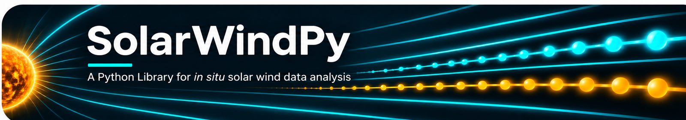

SolarWindPy Documentation
=========================

|CI| |Docs| |Ruff|

|PyPI| |Conda|

|Python| |License| |DOI|

.. |CI| image:: https://github.com/blalterman/SolarWindPy/actions/workflows/ci-master.yml/badge.svg?branch=master
   :target: https://github.com/blalterman/SolarWindPy/actions/workflows/ci-master.yml
   :alt: CI status
.. |Docs| image:: https://img.shields.io/readthedocs/solarwindpy.svg
   :target: https://solarwindpy.readthedocs.io/
   :alt: Documentation status
.. |Ruff| image:: https://img.shields.io/endpoint?url=https://raw.githubusercontent.com/astral-sh/ruff/main/assets/badge/v2.json
   :target: https://github.com/astral-sh/ruff
   :alt: Ruff
.. |PyPI| image:: https://img.shields.io/pypi/v/solarwindpy.svg
   :target: https://pypi.org/project/solarwindpy/
   :alt: PyPI version
.. |Conda| image:: https://img.shields.io/conda/vn/conda-forge/solarwindpy.svg
   :target: https://anaconda.org/conda-forge/solarwindpy
   :alt: conda-forge version
.. |Python| image:: https://img.shields.io/pypi/pyversions/solarwindpy.svg
   :target: https://pypi.org/project/solarwindpy/
   :alt: Supported Python versions
.. |License| image:: https://img.shields.io/badge/License-BSD%203--Clause-blue.svg
   :target: https://github.com/blalterman/SolarWindPy/blob/master/LICENSE
   :alt: License
.. |DOI| image:: https://img.shields.io/badge/DOI-10.5281%2Fzenodo.17042839-blue.svg
   :target: https://doi.org/10.5281/zenodo.17042839
   :alt: Zenodo DOI

A Python Library for *in situ* solar wind data analysis. This package
provides tools for processing spacecraft measurements, calculating derived
quantities, and visualizing results with scientific accuracy.

.. toctree::
   :maxdepth: 4
   :caption: User Guide

   installation
   tutorial/quickstart
   usage
   missing_data
   citing
   related_packages

.. toctree::
   :maxdepth: 2
   :caption: Development

   contributing
   code_of_conduct

.. toctree::
   :maxdepth: 4
   :caption: API Reference

   api_reference

.. include:: ../../LICENSE

Indices and tables
==================

* :ref:`genindex`
* :ref:`modindex`
* :ref:`search`
